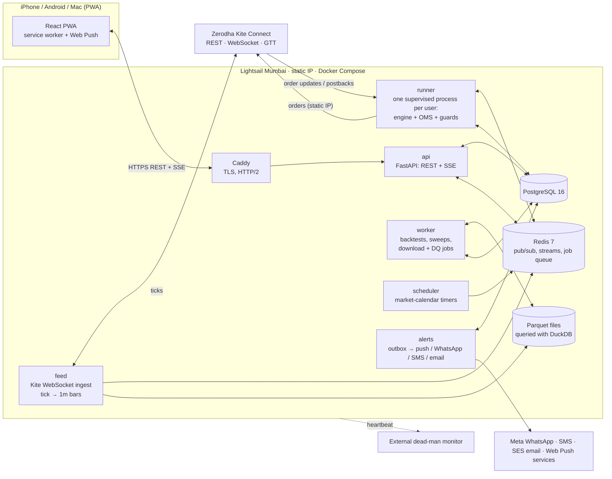
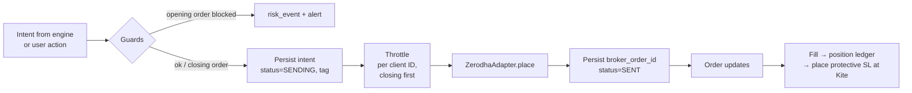
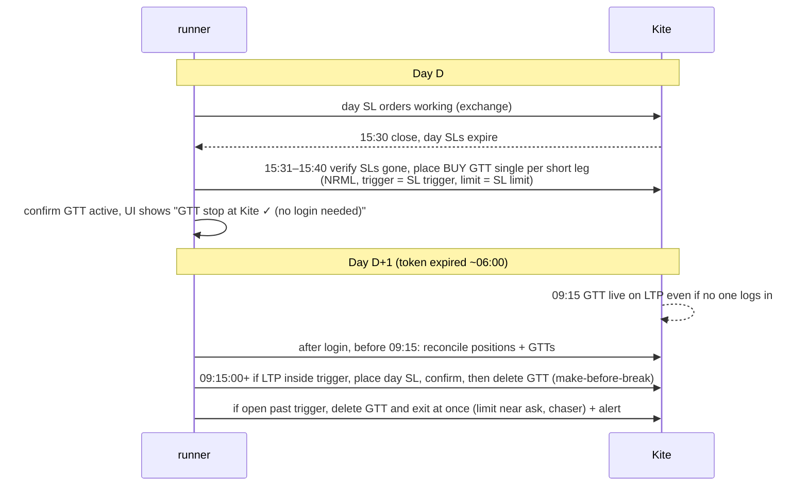

# TradeDesk — technical architecture (v1.0, 22 Oct 2026)

Author: solution-architect agent · Status: **draft for owner approval** · Inputs: CLAUDE.md, product brief,
design decisions, UI review round 3, the 16 approved prototypes, skills `strategy-spec` and
`indian-market-rules`, and the research cited in §16 (checked 22 Oct 2026).

> **Overnight protection, in one line:** Zerodha supports GTT on F&O (NFO/BFO) with NRML, on both
> buy and sell sides, as single trigger or OCO, so each overnight short leg gets a **BUY GTT stop**
> placed after the close. It works without a daily login. The trigger is not guaranteed to fill, and
> the API path for NFO is not proven yet, so a 1-lot live test is a go-live gate (§6.6).

---

## 1. Context and constraints

| Item | Value |
|---|---|
| Users | Owner (admin) + 2–4 family members. Each has their own login, Zerodha account and Kite Connect app |
| Instruments | Index options (NIFTY, BANKNIFTY, FINNIFTY, SENSEX) + equity **intraday only** (no CNC in v1) |
| Capital and risk | ≈₹2 L per strategy; defaults 2% risk per trade (₹4,000), 4% max loss per day (₹8,000), editable per strategy |
| Load | < 1,000 subscribed instruments, < 20 concurrent sessions, < 200 orders/day across all users |
| Team | One developer working with Claude Code, evenings only. Ops must be close to zero |
| Budget | One small server in Mumbai (~₹2–3k/month) + Kite Connect ₹500/month per live user + alert costs |
| Regulation | SEBI retail-algo framework (from 1 Apr 2026): orders only from a registered app on a whitelisted static IP, 2FA every trading day, ≤ 10 orders/sec per client |

**Guiding rules.** Use boring tools. Use one language for everything that touches money (Python). Every
safety promise in the UI must map to one component that enforces it and one test that proves it (§6.9).
Nothing a phone does is ever required to keep a position safe.

---

## 2. System overview



**Key decision: separate processes on one host, connected through Redis and Postgres.** A crash in a
backtest or in one user's runner cannot take down the feed or another user's live session.
*Rejected:* a single async monolith. It is simpler, but a CPU-heavy backtest stalls tick handling, and
one bug affects every user. *Also rejected:* Kubernetes or microservices on several hosts. That is far too much ops for one developer.

---

## 3. Module boundaries and repo layout

One monorepo. Python uses a `uv` workspace, and the web app uses `pnpm`. The strategy JSON Schema is the single
source for both Python (pydantic) and TypeScript (generated types).

```
tradedesk/
  apps/web/                 React + TS + Vite PWA, Tailwind, Lightweight Charts
  py/
    common/                 money (paise ints), IST clock, ids, crypto (envelope enc.), log redaction
    marketcal/              market_calendar, instruments dump, lot sizes/freeze qty/charges by date
    spec/                   JSON Schema, validator, no-code → Plan compiler, Python strategy SDK
    engine/                 event loop, indicators, Plan executor, fill models, risk calculator
    brokers/                BrokerAdapter protocol; zerodha/, paper/, fake/ (scriptable for tests)
    oms/                    order intents, state machine, guards, throttle, SL manager, reconciler
    marketdata/             Parquet store, bar builder, download jobs, data-quality checks
    services/api/           FastAPI app (REST + SSE), auth (WebAuthn), admin
    services/feed/          Kite ticker ingest → Redis + Parquet
    services/runner/        per-user session supervisor (paper + live)
    services/worker/        RQ workers: backtest, sweep, downloads, EOD jobs
    services/alerts/        outbox dispatcher + providers
    services/scheduler/     calendar-aware timers (login reminders, 09:15 SL placement, EOD GTT)
  tests/golden/ tests/chaos/ tests/contract/
  infra/                    docker-compose.{prod,staging}.yml, Caddyfile, backup + restore scripts
  docs/ prototypes/ .claude/
```

**Dependency rule:** `engine` imports neither `brokers` nor any service. It only sees an abstract
`ExecutionPort`, so backtest and live cannot drift apart. `oms` is the only package that imports
`brokers.zerodha`, and only `services/runner` constructs a live adapter.

---

## 4. One engine for backtest, replay, paper and live

### 4.1 Spec → Plan
1. **No-code:** the builder edits the strategy JSON (skill `strategy-spec`). The API validates it against the JSON
   Schema on every save. `risk.stop_loss` and `risk.max_loss_per_day` are required, so a strategy
   without them **cannot be saved** for paper or live.
2. **Python (advanced, owner-authored):** a class declares the same `instrument/schedule/risk/params`
   blocks and implements `on_bar(ctx)`. It can only emit *intents* through `ctx` (enter, exit,
   modify SL). It never holds a broker object. It runs in its own subprocess with CPU and memory limits.
3. **Compile:** spec → immutable `Plan`. A Plan contains an indicator DAG (deduplicated), condition evaluators, leg
   selectors (atm_offset / premium / delta / strike), a sizing rule (`from_risk`), stop and target rules with
   **owner and unit** (`option · at Kite` vs `NIFTY spot · app-held`), and schedule gates. The Plan is hashed,
   and every run stores `strategy_version_id` and `plan_hash`.

*Rejected:* arbitrary Python for no-code expressions (unsafe and not portable). *Rejected:* compiling to a
different runtime for live, such as a broker's own algo platform (two engines would diverge).

### 4.2 Event loop
```
Clock (sim or wall, IST) → DataSource.next_event() → Engine.on_event()
   bar_close / tick / order_update / timer(schedule) / risk_event
Engine → Plan.evaluate() → Intents → ExecutionPort
   backtest/replay: SimulatedExecution (fill model)
   paper:           PaperBroker (same BrokerAdapter interface, live prices)
   live:            OMS → guards → throttle → ZerodhaAdapter
```
- Bars align to 09:15 IST, and signals act on **bar close**. App-held stops (for example a NIFTY spot stop) are
  checked on every tick in paper and live, and on intrabar high/low in backtest.
- **Determinism:** time comes only from `Clock`. There is no `datetime.now()` in the engine, and money is integer paise.
  Prices are Decimal rounded to tick size, sort orders are stable, random seeds are fixed, and data snapshots are versioned
  (`dataset_version`). Same spec + same data ⇒ byte-identical trade list (golden tests, §13).
- **Fill model (backtest/replay):** limit fills when the bar trades through the price, with configurable slippage (default 0.5%).
  SL fills at the worse of trigger and open when a bar gaps past it. **If the bar gaps past the SL limit, the stop is
  modelled as not filled** and the chaser logic (§6.4) runs on later bars. Charges come from the dated
  `charges` table. Lot size comes from the contract's expiry date.
- Paper and live differ from backtest **only in fills**, as the spec requires.

---

## 5. Broker adapter

```python
class BrokerAdapter(Protocol):
    # session
    def login_url(self) -> str
    def complete_login(self, request_token: str) -> Session         # daily 2FA via Kite's own page
    def session_status(self) -> SessionStatus                       # valid / expired / invalidated
    # reference + data
    def instruments(self, exchange: str) -> list[Instrument]        # daily dump, cached by date
    def quotes(self, keys: list[str]) -> dict[str, Quote]           # incl. circuit limits, depth
    def historical(self, token, interval, start, end, oi=False) -> Bars
    def stream(self, tokens, mode) -> AsyncIterator[Tick]           # feed service only
    # account
    def positions(self) -> Positions; def orders(self) -> list[Order]; def trades(self) -> list[Fill]
    def margins(self) -> Funds;  def basket_margin(self, legs) -> MarginEstimate
    # orders
    def place(self, req: OrderRequest) -> BrokerOrderId             # req.tag = idempotency tag
    def modify(self, oid, changes) -> None; def cancel(self, oid) -> None
    def find_by_tag(self, tag: str) -> Order | None                 # restart recovery
    def place_gtt(self, req: GttRequest) -> GttId; def delete_gtt(self, gid); def gtts(self)
    def order_updates(self) -> AsyncIterator[OrderUpdate]           # WS / postback / poll merged
```

- **Errors** map to one taxonomy: `TokenExpired`, `RateLimited`, `MarginInsufficient`, `Rejected(reason)`,
  `InputInvalid`, `NetworkUnknown` (*request may or may not have reached the OMS*), and `BrokerDown`. Callers
  must treat `NetworkUnknown` as "maybe placed" and resolve it with `find_by_tag` before any retry.
- **Idempotency:** Kite has no client order ID. Its `guid` field is documented as unusable, and the `tag`
  field (≤ 20 alphanumeric characters) is a label. TradeDesk therefore writes an `order_intents` row first, derives a
  unique 20-char `tag` from its ID, and before any resend checks the order book for that tag. The order book is
  cleared at beginning of day, so tags never need to live past one day.
- **Order updates:** Kite WebSocket order updates (Connect plan), plus a 2-second order-book poll while
  any order is open, merged and de-duplicated by `(order_id, status, filled_qty)`.
- **PaperBroker** implements the same protocol. It fills against live quotes using the backtest fill model and
  **has no network code for orders**. Live mode is the only mode that constructs `ZerodhaAdapter`'s
  order client (reviewer rule).
- **FakeBroker** is scriptable for tests: inject rejects, partial fills, 429s, timeouts, disconnects and gaps.
- Later brokers (Upstox, Dhan, …) implement the same protocol. Nothing outside `brokers/` changes.

**Kite plan per user (decision).** Each live user subscribes to **Kite Connect at ₹500/month** on their
own app, under the owner's single developer account as Zerodha prescribes for families sharing one static IP.
Reasons: WebSocket order updates (the free *Personal* plan returns 403 on WebSocket and has no market data),
a feed that can fail over to any logged-in user's token, and no question about passing one user's market data to another.
Paper-only users need no app. *Rejected:* Personal (free) apps for family plus the owner's feed. It saves ₹500/user,
but order updates would depend on postbacks or polling, and the feed would die whenever the owner skips a login.

---

## 6. Order management and safety layer

### 6.1 Order path

- **Guards (opening orders only; closing orders are never blocked):** live session is armed, broker token is valid,
  the feed is fresh, reconciliation is OK, inside schedule and before `no_new_after`, not an expiry cut-off,
  lots ≤ max lots/order, opening orders today < max/day, the day is not locked, worst case at the SL **limit** ≤ accepted
  ₹ budget, free margin covers it (`basket_margin`), and the price is inside circuit limits. Quantity = lots × lot size
  (from the dated instruments table), split above the freeze quantity.
- **Order types:** LIMIT and SL only. **Never MARKET or SL-M on options.** Zerodha blocks SL-M on index options,
  and from 1 Apr 2026 market or SL-M algo orders need non-zero market protection. Exits are LIMIT at ask (buy) or bid
  (sell), re-priced every 5 s for at most 30 s (the "re-price ≤ 30 s" promise). Kite allows 25 modifications per order, so the
  chaser cancels and replaces before reaching that.
- **Throttle:** a token bucket per Kite client ID at **8 orders/s**, leaving headroom under the hard 10/s (excess gets HTTP 429).
  Place, modify, cancel and GTT calls all count, as a precaution; whether modifications count is not confirmed. Protective
  and closing orders jump the queue. A 429 is retried with backoff, never dropped.
- **Single writer:** all order actions for a user, including manual taps from the phone, go through that user's
  runner. The API only enqueues commands, so there is one throttle and one state machine per account.

### 6.2 Protective stops at the broker
- Every entry fill places, within the same handler, a **BUY/SELL SL order at Kite** (trigger + limit). For short
  options, limit = trigger × (1 + buffer) rounded to tick, with a default buffer of 10% (prototypes: 127.50 → 140.25). All worst
  cases shown in the UI are computed by one shared `risk_calculator` **at the SL limit**, with the label "more if it doesn't fill".
- **App-held stops** (spot, ATR, Supertrend line) are evaluated by the runner on ticks. In live they always get a
  **backstop SL at Kite** at the strategy's backstop level (default −40% of premium for long options) so that "if app
  down" has a number.
- **Exit without double orders:** a manual exit, a target, the daily-loss lockout or Stop all **modifies the existing SL
  order into a LIMIT exit**. It does not place a second order and then cancel the SL, so a position can never be closed twice
  and flipped. *UI copy change:* OrderSheet says "Then cancel SL order"; it should say "Your SL order at Kite becomes
  the exit order". The ability to change `order_type` with Kite's modify endpoint is to be confirmed in the 1-lot test. The fallback is
  cancel-then-place, with the SL kept until the cancel is confirmed.
- When a leg exits or rolls, its SL and GTT are cancelled or modified in the same transaction. An orphan scan runs every minute
  and at EOD.

### 6.3 Reconciliation
Reconciliation runs before the first order of the day, after every restart, every 60 s, and on every fill. It compares broker
**net quantity per instrument and product** with the sum of the expected quantities of all of that user's live sessions, plus
the expected open SL orders and GTTs.
- **Mismatch:** (1) **resize each broker SL to the actual position quantity first** (P0 #3: an SL for 130 when the position is 65 would
  leave the user long); (2) stop the affected strategies so no new orders are sent; (3) send an alert and open the Incident screen.
  Resuming requires a LIVE slide that re-runs reconciliation.
- One live strategy per instrument per user at a time (guard), so the per-account aggregate is unambiguous.

### 6.4 Incident behaviours
- **Rejection on a multi-leg entry:** legs go out in a fixed order, with the hedge or lower-risk leg first where relevant. A reject stops before the
  next leg. Any filled leg is squared off, the strategy is paused for the day, Kite is checked for "nothing open", and an alert is sent.
  "Keep paused" is the default. A retry goes back through the risk sheet at 1 lot.
- **Partial fill:** the SL is sized to the filled quantity immediately; the rest is cancelled, then the strategy squares off, stops and alerts.
- **SL triggered, not filled** (the SL chaser): when the trigger is crossed and the order is still open after 5 s, raise the limit to ask every 5 s for 6 tries,
  then go to ask + 2% and keep trying. If the daily cap is already passed, exit **all** legs of the strategy (the profitable leg at bid or ask).
  Each step is logged and alerted.
- **Open past trigger** (overnight legs at 09:15): the leg is exited at once with a limit near the ask, then chased as above.
- **Daily loss limit:** the runner computes MTM net of charges on every tick. At ≥ the limit, it converts all live SLs into exits (no double
  orders), confirms the fills, and **locks LIVE for the user until the next trading day 09:15** (`day_locks` row). Paper keeps running.
- **Kill switch / Stop all:** the command is idempotent (client-generated `command_id`). It aborts every pending re-price loop, cancels
  unfilled entries, converts SLs into exits for all live legs, stops paper sessions, and blocks new entries for the day. The phone never
  queues it offline (review #11). If the phone can't reach the server, the screen says so and shows the Zerodha Call & Trade number.
- **Token expired or invalidated mid-day** (TokenException): treated as a broker outage. Entries pause and alerts escalate. Broker SLs
  keep working. The user is asked to re-login.

### 6.5 Restart safety
The intent row is written as `SENDING` (with its tag) **before** the HTTP call, and `SENT`/`FAILED` after it. On boot the runner loads
sessions, then fetches orders, positions and GTTs from Kite. It resolves every `SENDING` row by tag (found → adopt; not found after 30 s → mark
failed), then reconciles. **Only then** does it resume. Systemd/Docker restarts the runner at once. A boot during market hours raises an alert.

### 6.6 Overnight protection for NRML short legs
**Research result.** Zerodha's GTT is available for NRML, CNC and MTF. "Buy GTT OCO" is allowed *only* in F&O contracts, and
index F&O OCO GTTs must use NRML. The June 2026 trailing-GTT release lists NFO and BFO with buy and sell GTTs. GTTs need no margin, last up to
365 days, and allow 500 active per account. **Caveats:** a GTT triggers on LTP during market hours only, including when the
price gaps through the trigger. On trigger it sends a LIMIT order (the API documents LIMIT only), so **execution is not guaranteed**. The trigger is single-use,
and an unfilled order is cancelled at day end. The GTT does not know about the position: if the leg is closed some other way, it can open a new
position. A 2024 forum thread shows API users struggling with NFO GTTs (the product had to match NRML).

**Plan (decision):**

- **Make-before-break:** for about one second both the SL and the GTT exist. If both fire, the extra fill is a *long* option (bounded loss), and the
  reconciler exits it at once. The opposite order of steps would leave a short leg with no stop at all.
- **Why not place the GTT at 15:20?** The day SL and the GTT would both be live, and both could fire on a late spike.
- The Login and States screens change from "no SL at Kite overnight" to **"GTT stop at Kite · fills only if price is at or under limit ₹140.25"**. The worst case
  stays priced at the GTT limit.
- **Option (owner):** a wider overnight GTT limit (for example trigger × 1.25) improves the chance of a fill on gap opens but raises the displayed worst case.
- **Complement (recommended for strangles):** buy far-OTM wings (iron condor) to cap gap risk outright. It also cuts SPAN margin.
- **Go-live gate:** a scripted 1-lot test on a cheap far-OTM NIFTY option: SELL NRML → BUY GTT via API → confirm it triggers, fills and closes
  (not opens) the position. Without a pass, overnight NRML shorts stay disabled in live.

### 6.7 Feed and outage behaviour
- **Feed stale** (no index tick for 5 s in market hours): new entries pause and the banner appears. The feed reconnects every 5 s, and the runner switches to **REST quote polling
  (1 req/s, many instruments per call) for held instruments**, so app-held stops and the daily square-off keep working in degraded mode. Alerts escalate at
  30 s. Broker SLs are the cap in the meantime.
- **Broker down / 5xx:** no new entries; existing broker SLs remain; retry with backoff; alert.
- **Server down:** broker SLs and GTTs protect the positions. An external dead-man monitor (heartbeat every 30 s) alerts all users by SMS and email
  within 2 minutes.

### 6.8 SEBI framework compliance
Orders leave only from the Lightsail static IP, registered in the owner's Kite developer profile. One primary IP plus an optional secondary IP is allowed; the secondary is kept
for DR, and the IP can be changed once per week. The family declaration is limited to spouse, dependent children and dependent parents. Each user has their own app and completes daily 2FA on Kite's own page.
Throughput stays ≤ 10 orders/s per client. Algo-ID tagging is applied by the broker and exchange. Kite exposes no field for it, so TradeDesk uses `tag` only for its own
use. The empanelment question for strategies shared outside the family stays open (§15).

### 6.9 Promise → enforcing component

| UI / design promise (source) | Enforced by | Proven by |
|---|---|---|
| No save for paper/live without SL + max daily loss (CLAUDE.md) | `spec` validator (API + runner re-check) | schema tests |
| Builder blocks when 1 lot > risk budget unless accepted (DD) | `risk_calculator` + `strategy_versions.risk_acceptance_inr` | unit |
| Worst case priced at SL **limit**, "more if it doesn't fill" (R3 #2) | `risk_calculator` (single source for UI and guards) | golden numbers (−₹24,310) |
| Strangle blocks when app-down worst > 4% day cap unless exact ₹ accepted (DD, R3 #10) | validator + acceptance record | unit |
| App-held stops always get a backstop SL at Kite (DD) | `oms.sl_manager` | FakeBroker |
| Every entry gets a broker SL; never orphaned (reviewer) | `sl_manager` + orphan scan | chaos |
| LIVE P&L net of charges; PAPER never summed (DD) | `pnl` service + `charges` table | unit |
| Deploy flags size ≠ backtest size (DD) | API compares `runs.lots` | unit |
| Mismatch → resize SL first, stop, resume via LIVE slide (R3 #3) | `oms.reconciler` | FakeBroker |
| Reject → stop before 2nd leg, pause, check nothing open, retry at 1 lot (R3 #5) | `oms.multileg` | FakeBroker |
| Lots capped by free margin (R3 #5) | guard via `basket_margin` | contract test |
| SL not filled → chase 6× then ask+2%; past cap → exit both legs (R3 #4) | `oms.sl_chaser` | chaos |
| Open past trigger → exit at once + alert (R3 #6) | `scheduler` 09:15 job + `sl_chaser` | sim clock test |
| Overnight shorts protected without login (R3 #6) | EOD GTT job (§6.6) | 1-lot live test |
| Daily loss limit → SLs become exits, lock till next day (Incident) | runner MTM + `day_locks` | chaos |
| Stop all, no queued Stop all when offline (R3 #11) | `kill_switch` + PWA (no offline queue) | e2e |
| Feed stale → pause entries, REST fallback (States) | `feed` health + runner | chaos (drop WS) |
| Phone offline → server continues; SMS + email (States) | `alerts` router uses presence | unit |
| Login reminders 08:30/08:45; 09:15 countdown (Login) | `scheduler` + `alerts` | sim clock test |
| "Kite [client ID]" on LIVE commits (R3 #9) | API returns `broker_accounts.client_id_masked` | e2e |
| Live unlock: 20 paper trades in range, review passed, IP, margin, backstop (Promote) | `promotion` service | unit |
| Start at 1 lot for 5 days (Promote) | `live_limits.starter_until` | unit |
| ≤ 10 orders/s, max orders/day, max lots/order (CLAUDE.md) | `throttle` + guards | load test |
| Paper never calls the order API (reviewer) | PaperBroker has no order client; live adapter built only in live mode | import-lint + test |

---

## 7. Market data

- **Ingest:** the `feed` service holds Kite WebSocket connections (limits: 3,000 instruments per connection, 3 connections per API key). Mode
  `full` for held and chain instruments, `quote` for scanner symbols. It publishes ticks to Redis Streams (`ticks:{token}`, last 10 min retained)
  and builds 1-minute bars (OHLC, volume delta, OI) aligned to 09:15. Higher timeframes are resampled from the 1-minute bars.
- **Subscription manager:** daily from the instruments dump. Index spot and VIX, NIFTY/SENSEX weekly ±25 strikes for 2 expiries, monthly for
  BANKNIFTY/FINNIFTY, held instruments always, and the equity watchlist. That is well under 1,000 instruments.
- **Storage (decision): Parquet + DuckDB.** Partitions are `bars_1m/{segment}/{underlying}/{yyyy}/{mm}/{date}.parquet`. Today's bars are flushed every
  5 min and compacted at EOD. Raw ticks are kept only for held instruments (30 days) for fill audits. Everything is mirrored to S3.
  *Rejected:* TimescaleDB. It is a good product, but it needs another always-on database to tune and back up, uses more RAM, and is slower for columnar backtest
  scans. DuckDB reads Parquet in-process and costs no ops.
- **Historical jobs (worker):** Kite historical (3 req/s; minute data for **live contracts only**; continuous day candles for expired futures).
  The nightly job (1) saves the instruments dump (Kite flushes expired tokens), (2) downloads today's minute bars + OI for every subscribed option,
  and (3) runs data-quality checks. **Start recording now:** each week of delay is a week of option history that must be bought later.
- **Expired-options gap:** Kite has no data for expired options. Buy one-time history (2023 to now, NIFTY/BANKNIFTY/FINNIFTY/SENSEX minute bars) from a
  vendor. Candidates are GDFL and TrueData; price and licence are not verified. Imports are normalised into the same Parquet schema with `source=vendor`.
  Backtests report the **share of fills on real option prices**, as the Backtest screen does ("Real option prices: 100% of fills"). Fills from a model (BS from spot + IV)
  are flagged.
- **Data-quality checks:** missing minutes compared with `market_calendar`, OHLC consistency, duplicate timestamps, zero-volume runs, jumps over
  N×ATR, lot size and expiry compared with the dated reference, and vendor-versus-Kite overlap comparison. Results feed the Data screen coverage calendar.
- **Stale detection:** per-instrument last tick time, plus a feed heartbeat. Index tokens have a 5-second budget during market hours. The state is published to every client.

---

## 8. Data model (PostgreSQL, key columns)

```
users(id, email, role[owner|trader], created_at, disabled_at)
passkeys(id, user_id, credential_id, public_key, sign_count, label, last_used_at)
broker_accounts(id, user_id UNIQUE per broker, broker, client_id_masked, api_key_enc, api_secret_enc,
                access_token_enc, token_expires_at, data_key_enc, status, last_login_at)
risk_profiles(user_id, capital_inr, risk_per_trade_pct, max_daily_loss_pct, max_lots_order,
              max_orders_day, callandtrade_phone)
strategies(id, owner_user_id, name, kind[nocode|python], shared bool, archived_at)
strategy_versions(id, strategy_id, version, spec_json, plan_hash, risk_acceptance_inr,
                  risk_acceptance_pct, created_by, created_at)              -- immutable
runs(id, strategy_version_id, user_id, mode[backtest|replay|sweep], params_json, dataset_version,
     start, end, capital, lots, cost_model, status, stats_json, real_price_fill_pct, artifact_path)
sessions(id, strategy_version_id, user_id, mode[paper|live], broker_account_id, state
         [armed|running|paused|stopped|locked], lots, starter_until, started_at, stopped_reason)
order_intents(id, session_id, user_id, leg_ref, purpose[entry|sl|backstop|exit|gtt], side, tradingsymbol,
              product, order_type, qty, price, trigger, tag UNIQUE, status, broker_order_id,
              attempts, created_at, sent_at)                            -- written BEFORE send
broker_orders(broker_order_id, intent_id, status, filled_qty, avg_price, raw_json, updated_at)
fills(id, broker_order_id, session_id, qty, price, charges_paise, ts)
gtts(id, session_id, broker_gtt_id, leg_ref, trigger, limit, status, placed_at, removed_at)
position_snapshots(id, user_id, ts, source[broker|ledger], positions_json, matched bool)
risk_events(id, user_id, session_id, kind, severity, details_json, ts)  -- guards, mismatches, locks
day_locks(user_id, trading_date, reason, locked_at)
alerts(id, user_id, severity, kind, title, body, dedupe_key, created_at, acked_at)
alert_deliveries(id, alert_id, channel, provider_msg_id, status, attempt, ts)
journal_entries(id, user_id, trade_ref, setup_tag, note, attachments, created_at)
commands(id[client uuid], user_id, kind[stop_all|exit_leg|modify_sl|resume], payload, status, ts)
audit_log(id, actor_user_id, action, target, ip, user_agent, ts)        -- append-only
market_calendar(date, exchange, is_trading, special_session, notes)
instruments(date, token, tradingsymbol, segment, expiry, strike, type, lot_size, tick, freeze_qty)
charges(effective_from, segment, component, rate, cap)
```
Every user-scoped table carries `user_id`, and the API's repository layer injects `WHERE user_id = :me` (owner admin views read only
aggregates). Money is stored in integer paise and times in UTC `timestamptz`, displayed in IST.

---

## 9. Real-time path to the phone

- **SSE** (`/v1/stream`) per signed-in device carries P&L, positions, orders, session states, feed health and alerts. Throttled to 2 updates/s
  per topic. Each event has an ID; on reconnect the client sends `Last-Event-ID` and the server replays from a Redis stream, or sends a fresh
  snapshot if the gap is too old. Commands go over REST (`POST /v1/commands`) with a client `command_id` and need a server ack.
  *Rejected:* WebSocket. Bidirectional traffic isn't needed. SSE reconnects automatically, passes through Caddy/HTTP2 cleanly and is simpler to secure.
- **Order of display after reconnect:** prices and feed age first, then positions, then the prompt again (States screen: "on reconnect we show prices first").
- **Offline phone:** the service worker caches the app shell and the last snapshot, shown with "last seen hh:mm" and greyed out. **LIVE commands are disabled offline, never
  queued.** The server does not depend on the phone. Sessions continue under their limits, and a device with no SSE connection for > 60 s
  is treated as away, so alerts route to SMS and email as well as push.

---

## 10. Auth and multi-user isolation

- **TradeDesk login:** passkeys (WebAuthn: Face ID / Touch ID) with an email magic link only for enrolling a new device, plus printed recovery
  codes. Session is an HttpOnly, Secure, SameSite=strict cookie. **Step-up:** LIVE slides (start live, resume, Stop all is *exempt* so
  it is never blocked) require a passkey assertion within the last 12 h.
  *Rejected:* passwords + TOTP (more friction on a phone, phishable).
- **Daily Kite login:** "Log in with Kite" opens Kite's own page. The callback `/v1/brokers/kite/callback/{account}` receives
  `request_token`, the server exchanges it with the encrypted secret, and stores the access token until about 06:00 the next day. TradeDesk never sees the Kite password or TOTP.
  Reminders go out at 08:30 and 08:45. If no one logs in, open overnight legs rely on the GTT (§6.6).
- **Secrets:** envelope encryption. Each broker account has a random data key (AES-256-GCM) encrypted by a master key in **AWS KMS** (Mumbai).
  Decryption happens only inside that user's runner, and inside the API during the login callback. Secrets are never in logs (a structured-log redaction filter blocks
  `api_secret`, `access_token`, `request_token`, `enctoken`), never in URLs and never sent to the client.
  *Rejected:* a key in an `.env` file, because then a leaked backup also leaks every key.
- **Isolation:** one runner process per user, started with only that user's ID. It can load only its own `broker_accounts` row (enforced by DB
  row-level security policy on the runner's DB role).
- **Audit log:** append-only. It records logins, Kite logins, live starts, slides, Stop all, risk acceptances, settings changes and admin actions.

---

## 11. Alerts

| Severity | Examples | Channels |
|---|---|---|
| Info | fills, rolls, signals | push (+ in-app) |
| Warn | feed stale > 30 s, reject, mismatch, login reminder | push + WhatsApp (+ SMS if away) |
| Critical | SL not filled, daily lock, server/broker down, open past trigger | push + WhatsApp + SMS + email, repeat every 2 min until acknowledged |

- **Outbox pattern:** alerts are written to `alerts` in the same transaction as the event. The dispatcher retries per channel and de-duplicates by `dedupe_key`.
- **Web Push** (VAPID, self-hosted with `pywebpush`): works on iOS 16.4+ **only once the PWA is added to the Home Screen** (manifest
  `display: standalone`), with the permission request inside a tap. Removing the icon kills the subscription. Safari revokes permission if the
  service worker fails to show a notification, so it must always show one. Push is best-effort, which is why critical alerts never rely on it alone.
- **WhatsApp:** Meta **Cloud API directly**, with no BSP fee. It needs a Meta Business account, a dedicated number and approved *utility* templates
  (for example "TradeDesk: {{1}} on {{2}}. Open risk {{3}}."). India utility rate ≈ **₹0.145/message** (Oct 2026). At about 3,000 messages/month that is ≈ ₹450.
  *Rejected:* a BSP such as AiSensy or Gupshup (monthly fee, no benefit at this volume).
- **SMS:** commercial A2P SMS in India needs **TRAI DLT** registration of entity, sender header and templates (≈ ₹5,900 + GST for the entity, ≈ ₹590/year per header,
  2–4 weeks). Choices for the owner: (a) DLT through an Indian provider (MSG91, Exotel) if the owner has or can register an entity;
  (b) **for v1, an Android SMS-gateway app** on a spare phone with a family SIM (low volume, person-to-person, no DLT, ₹0). This is less reliable, and the
  dead-man monitor watches it. Recommendation: (b) now, (a) before more users join.
- **Email:** Amazon SES (Mumbai).
- **Free extra:** a Telegram bot is optional per user. It is free and has reliable sound and priority.
- **Server death:** a Healthchecks.io-style monitor emails and SMSes the owner independently of the server.

---

## 12. Deployment

- **Host:** AWS **Lightsail Mumbai (ap-south-1)**, 4 GB RAM / 2 vCPU, with a Lightsail **static IP** (free while attached). Upgrade to 8 GB if sweeps
  need it. *Rejected:* EC2 + Elastic IP (more knobs, similar price); an Indian VPS (weaker snapshots and KMS); serverless (no long-lived feed or
  runner). Pricing was not re-verified this session.
- **Processes** (Docker Compose): `caddy`, `api` (2 workers), `feed`, `runner-supervisor` (spawns per-user runners), `worker` (2 RQ workers,
  nice'd), `scheduler`, `alerts`, `postgres`, `redis`. Restart policy `always`. CPU shares favour feed and runner over worker.
- **Time:** chrony against Amazon Time Sync. An alert fires if the offset exceeds 100 ms. The trading calendar comes from the `market_calendar` table, never cron alone.
- **Backups:** nightly `pg_dump` plus 5-minute WAL archiving to S3 (pgBackRest), daily Lightsail snapshot, Parquet synced to S3. **A monthly restore drill**
  to staging.
- **Monitoring:** `/health` per service; Sentry for errors; JSON logs with redaction, rotated locally and shipped to S3; a dead-man heartbeat; a daily
  09:00 pre-flight report (token status, IP, feed, disk, clock).
- **Secrets:** KMS master key; app config in an SSM Parameter Store SecureString loaded at start.
- **CI/CD (GitHub Actions):** lint (ruff), mypy, unit + golden + contract tests, build images to GHCR, then **auto-deploy to staging**. Prod deploys are manual approval
  and **blocked 09:00–15:40 IST on trading days** unless it is a hotfix the owner overrides.
- **Staging:** a smaller Lightsail instance, **paper only**, whose IP is *not* whitelisted with Kite. Even a bug cannot place a real order there. It uses a read-only
  Kite session (owner's) for the live feed.
- **At 100 users:** separate feed/runner hosts and the API; Postgres on managed RDS; a per-user static IP becomes impossible to share (non-family), so it needs
  the empanelled-provider route or broker-hosted algos; WhatsApp/SMS volume tiers; a real queue (still Redis) and horizontal runners.

---

## 13. Testing strategy

- **Engine golden tests:** fixed datasets (a few real days, including a gap day, an expiry day and a holiday-shifted expiry) plus specs give a trade list and stats snapshot.
  Any diff fails CI. Backtest ⇔ replay equality test on the same spec and data.
- **Risk-calculator tests** use the prototype numbers (strangle −₹24,310 = −₹12,708 + −₹11,602, fixes −₹3,439 / −₹6,877).
- **Broker contract tests:** the same suite runs against `FakeBroker`, `PaperBroker` and (manually, 1 lot, flagged) `ZerodhaAdapter`.
- **Chaos tests (FakeBroker + sim clock):** feed drop mid-position; runner kill between `SENDING` and `SENT`; 429 storm; partial fill;
  reject on leg 2; SL not filling for 60 s; token invalidated mid-day; gap open past trigger; mismatch from a manual Kite trade; Stop all
  during a re-price loop; server reboot at 15:31 before the GTT is placed.
- **Live smoke (1 lot, far OTM, owner present):** place/modify/cancel, SL→LIMIT modify, GTT NFO buy-to-close, order updates, 10/s throttle.
- **Review gates (agents):** `order-execution-reviewer` on every PR touching `oms/`, `brokers/`, `services/runner/`; `backtest-auditor` on
  any published result; `ui-reviewer` on new screens; `risk-guard` weekly once paper starts. Promote's "Order safety review: Passed"
  reads the reviewer verdict recorded against the deployed commit.

---

## 14. Build plan (MVP milestones)

Effort is in focused developer-weeks with Claude Code. Evenings-only calendar time is roughly ×2. **Order change versus CLAUDE.md:** replay UI
moves after live, because the replay *engine* mode comes free with M2. Update CLAUDE.md when this document is approved.

| # | Milestone | Done when | Effort |
|---|---|---|---|
| M0 | Foundations: repo, CI, Lightsail + static IP, Caddy, passkeys, Kite daily login, KMS secrets, calendar + instruments | Owner logs in with Face ID and Kite; token stored encrypted; staging auto-deploys | 2 wk |
| M1 | **Data**: feed recorder, Parquet store, nightly downloads, DQ checks, vendor import, Data screen | 20 trading days recorded with zero DQ failures; vendor history loaded; coverage calendar shown | 3 wk |
| M2 | **Engine + Backtest**: spec v0, compiler, indicators, fill model, charges, results screen | ORB + strangle templates backtested 2023–26; golden tests green; backtest-auditor PASS | 4 wk |
| M3 | **Builder (no-code)** + templates + risk step | All 8 templates editable; SL/daily-loss enforced; acceptance flow per prototypes | 3 wk |
| M4 | **Analyser**: payoff, Greeks, margin via basket margin, what-if | Strangle payoff/margin matches Kite's within 2% | 2 wk |
| M5 | **Paper**: runner, PaperBroker, sessions, Home, push + email alerts | 2 strategies paper-traded 10 days unattended; restart test passes | 3 wk |
| M6 | **Orders**: ZerodhaAdapter orders, OMS, guards, throttle, SL manager, reconciler, chaser, Stop all, GTT job | All chaos tests green; order-execution-reviewer PASS; 1-lot live smoke incl. GTT passes | 4 wk |
| M7 | **Live**: promotion gates, incidents, WhatsApp + SMS, dead-man, pre-flight | First strategy live at 1 lot for 5 days with no unexplained mismatch | 2–3 wk |
| M8 | Replay UI, scanner, option chain, journal, reports | Screens pass ui-reviewer; journal stats by setup | 4 wk |
| | **Total** | | **≈ 27–28 wk** |

---

## 15. Open questions and risks for the owner

1. **GTT on the API for NFO buy-to-close:** documented for Kite and F&O but unproven via the API for our flow. OK to run the 1-lot live test (cost: brokerage plus a small slippage)?
   Until it passes, overnight NRML shorts stay paper-only.
2. **Overnight GTT limit width:** keep the intraday buffer (10%, worst case as shown today) or widen it (for example 25%, better gap fill, bigger worst case)?
3. **Wings on strangles** (iron-condor conversion) to cap gap risk and margin: make it the template default?
4. **Kite Connect ₹500/month per live user** (recommended) versus free Personal apps with weaker order updates. Confirm.
5. **SMS route:** an Android gateway phone now (needs a spare phone + SIM at home) or DLT registration (needs a business entity)?
6. **WhatsApp:** willing to set up a Meta Business account and a dedicated number?
7. **Expired-options vendor budget** for 2023–2026 minute data (quotes needed; price unknown).
8. **Confirm with Zerodha:** family sharing of strategies is not "provider" activity, and our use of one developer account with per-member apps fits their family-IP rule.
9. **Process for manual trades in the Kite app** on instruments a live strategy holds: these trigger a mismatch stop by design. Acceptable?
10. **UI copy changes** that follow from this design: overnight state shows the GTT stop; the exit sheet says "SL order becomes the exit order".
11. **Skill update:** `indian-market-rules` says MIS square-off "15:20–15:25". Zerodha now lists equity 15:25 and F&O 15:26 (₹50 + GST per order).
    The F&O pre-open (from 8 Dec 2025) covers futures only; options have none, and SL orders are not allowed in the call auction.
12. **Risk:** single server = single point of failure. Mitigated by broker SLs/GTTs and the dead-man alert, not removed. A warm standby on the secondary IP is a later option (about +₹2k/month).

**Not verified this session:** whether the 10/s limit counts modifications, cancels and GTT calls (we assume yes); GTT `MARKET` order type through the API;
whether Kite modify can change SL→LIMIT; Kite historical days-per-request limits; Lightsail and vendor prices; whether iOS web push can break through
Focus modes; whether Kite Connect terms allow one user's feed to serve family members (avoided by per-user Connect).

---

## 16. Sources (accessed 22 Oct 2026)

- Zerodha Support, *How can I use the GTT feature* — segments, OCO rules, 500 active, trigger timing, gap behaviour: https://support.zerodha.com/category/trading-and-markets/kite-features/gtt/articles/how-can-i-use-the-gtt-feature
- Zerodha Z-Connect, *Introducing Trailing Stoploss on Kite web* (23 Jun 2026) — GTT on NFO/BFO, buy and sell, single and OCO, execution not guaranteed: https://zerodha.com/z-connect/wp-json/wp/v2/posts/450973
- TradingQnA, *GTT now available for Index F&O* (May 2020): https://tradingqna.com/t/good-till-triggered-orders-gtt-now-available-for-index-f-o/76914
- Zerodha Support, *GTT stoploss for options*: https://support.zerodha.com/category/trading-and-markets/kite-features/gtt/articles/gtt-stoploss-option
- Kite Connect docs — GTT: https://kite.trade/docs/connect/v3/gtt/ · Orders: https://kite.trade/docs/connect/v3/orders/ · WebSocket: https://kite.trade/docs/connect/v3/websocket/ · Exceptions & rate limits: https://kite.trade/docs/connect/v3/exceptions/ · Historical: https://kite.trade/docs/connect/v3/historical/
- Kite forum, *Automation GTT* (2024, NFO GTT via API issues): https://kite.trade/forum/discussion/comment/46940/
- Kite forum, *Preparing to comply with SEBI's retail algo rules* (static IP, 10 OPS, market protection): https://kite.trade/forum/discussion/comment/52171
- Kite forum, expired-options historical data (staff): https://kite.trade/forum/discussion/comment/52370/
- Kite forum, *Kite Connect Personal APIs* (Mar 2025): https://kite.trade/forum/discussion/comment/49193/ · Personal plan WebSocket order updates: https://kite.trade/forum/discussion/14943/request-to-enable-websocket-order-updates-on-personal-api-plan
- Zerodha Support, *Static IP*: https://support.zerodha.com/category/trading-and-markets/general-kite/kite-api/articles/static-ip
- Zerodha Support, *Kite Connect API FAQs* (₹500/month, 10 OPS, token expiry, family IP): https://support.zerodha.com/category/trading-and-markets/general-kite/kite-api/articles/kite-connect-api-faqs
- Zerodha Z-Connect, *Overview of NSE's circular on the retail algo framework*: https://zerodha.com/z-connect/general/a-comprehensive-overview-of-nses-circular-on-the-new-retail-algo-trading-framework
- FYERS notice, *New SEBI framework for retail algo trading from 1 Apr 2026*: https://fyers.in/notice-board/new-sebi-framework-for-retail-algo-trading-from-april-01-2026/
- 5paisa, *SEBI tightens algo rules with mandatory 2FA and audit trails*: https://www.5paisa.com/news/sebi-tightens-algo-trading-rules-with-mandatory-2fa-and-audit-trails-from-april-1
- Zerodha Support, *Intraday auto square-off timings*: https://support.zerodha.com/category/trading-and-markets/trading-faqs/market-sessions/articles/intraday-auto-square-off-timings
- Zerodha Bulletin, *SL-M orders blocked for index options* (Sep 2021): https://zerodha.com/marketintel/bulletin/305785/stop-loss-market-sl-m-orders-blocked-for-index-options
- FYERS notice, *Pre-open session in equity derivatives* (futures only, from 8 Dec 2025): https://fyers.in/notice-board/introduction-of-pre-open-session-in-equity-derivatives-fo/
- Meta, *WhatsApp Business Platform pricing*: https://developers.facebook.com/documentation/business-messaging/whatsapp/pricing
- AiSensy, *WhatsApp pricing update October 2026* (India ₹0.145 utility): https://m.aisensy.com/blog/whatsapp-pricing-update-october-2026/
- Telerivet, *India SMS compliance: TRAI DLT*: https://www.telerivet.com/blog/india-sms-compliance-trai-dlt-registration-and-tcccpr-guide
- OneSignal, *Web push for iOS*: https://documentation.onesignal.com/docs/en/web-push-for-ios
